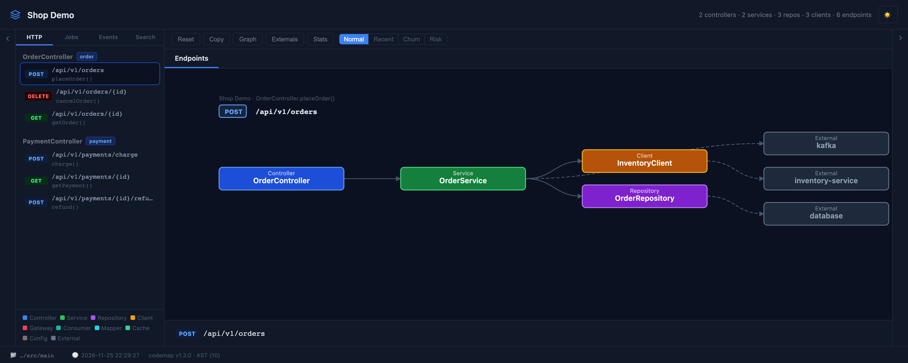
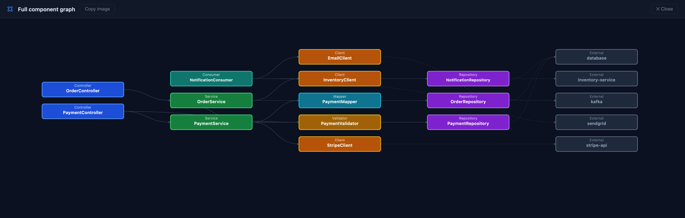
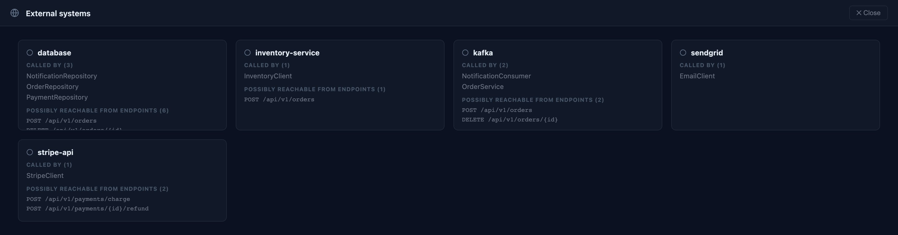
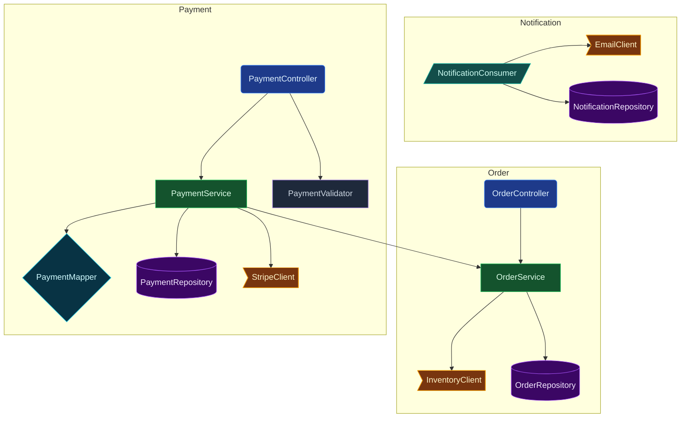
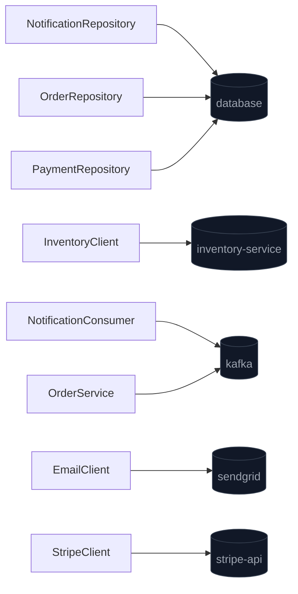

# codemap

**See how a Spring Boot application is wired together: from every endpoint, through services and repositories, out to the database, Kafka and the APIs it calls.**

codemap reads Kotlin and Java source code and builds an architecture map from Spring annotations and constructor injection. You don't need to add annotations or configuration, and nothing runs your app. Point it at a repo and it produces:

- an **interactive HTML map**: click an endpoint to see its call chain
- **`architecture.md`**: Mermaid diagrams and endpoint tables, ready to commit or give to an AI assistant
- **`codemap context`**: the call chain as plain text, for the terminal or a prompt

The map is built by static analysis (regex plus JavaParser and tree-sitter ASTs), so the same code always gives the same map.



<sub>All examples on this page come from the small demo app in [`tests/fixture-spring`](tests/fixture-spring): a shop with orders, payments and notifications.</sub>

---

## Quick start

```bash
pipx install git+https://github.com/esschul/codemap.git
cd your-spring-boot-repo
codemap . --serve
```

Your browser opens `http://localhost:8742/`. codemap finds the source root (`src/main`) by itself.

Requires Python 3.9+. Java 11+ on `PATH` is optional but recommended: it turns on the bundled AST scanners, which give more accurate fields and method calls.

---

## What you get

### Call chains per endpoint

Click an endpoint to see what it reaches. The chain follows the **methods the handler actually calls**, not every dependency of every class on the way. In the demo, `OrderService` has a `KafkaTemplate`:

- `POST /api/v1/orders` calls `kafkaTemplate.send(...)`, so Kafka is part of its chain (screenshot above).
- `GET /api/v1/orders/{id}` only calls `orderRepository.findById(...)`, so its chain stops at the database.

The same chain as plain text, with no browser:

```console
$ codemap context /orders
Endpoint: POST /api/v1/orders
Handler:  OrderController.placeOrder()
Call flow:
  OrderController.placeOrder  →  OrderService.placeOrder()
  OrderService  →  [kafka]
  OrderService.placeOrder  →  InventoryClient.reserve()
  InventoryClient  →  [inventory-service]
  OrderService.placeOrder  →  OrderRepository.save()
  OrderRepository  →  [database]

(DELETE /api/v1/orders/{id} omitted)

Endpoint: GET /api/v1/orders/{id}
Handler:  OrderController.getOrder()
Call flow:
  OrderController.getOrder  →  OrderService.findById()
  OrderService.findById  →  OrderRepository.findById()
  OrderRepository  →  [database]
```

### The whole component graph

**Graph** in the toolbar shows every component, its dependencies and the external systems it reaches:



### Which endpoints reach which external system

**Externals** groups the graph by external system. In the demo, `stripe-api` is reached from `charge` and `refund`, but not from `GET /payments/{id}`:



The map also has:
- **Jobs** and **Events** tabs for `@Scheduled`, `@KafkaListener` and `@EventListener` methods
- **Search** across components, endpoints, packages and external systems
- **Stats**: lines of code, fan-in/fan-out, orphan components, domain breakdown
- **Heatmap** modes that color nodes by git activity: Recent, Churn, and Risk (churn × number of dependents)

### `architecture.md` with Mermaid diagrams

`codemap .` also writes `architecture.md`. GitHub renders its diagrams directly. These two were generated from the demo app, unedited:





After the diagrams come endpoint tables and a table per domain with each component's kind, dependencies and external systems.

---

## Three ways to use it

### 1. Watch the architecture while you build

```bash
codemap live .        # = codemap . --serve --watch --debug-diff
```

codemap scans again every two minutes (set it with `--interval`). The browser shows a banner when a new scan is ready, and `--debug-diff` prints what changed: new components, endpoints and dependencies.

### 2. Living documentation on GitHub Pages

Publish the map so it updates on every push to main:

```bash
mkdir -p .github/workflows
curl -fsSL https://raw.githubusercontent.com/esschul/codemap/master/contrib/codemap-pages.yml \
  -o .github/workflows/codemap.yml
```

Commit the workflow, then set **Settings → Pages → Source** to the `gh-pages` branch. The map goes live at `https://<org>.github.io/<repo>/`. The workflow runs on every push to `main`/`master`, every Monday at 06:00 UTC, and on manual dispatch. A run takes about 30 seconds.

### 3. Context for AI-assisted development

Before you change a system with an AI assistant, give it the map:

```bash
codemap . --no-html          # architecture.md
codemap context /payments    # just the chains you are about to touch
codemap . --json --json-out graph.json   # the full graph, machine-readable
```

> "Here is the current architecture: [architecture.md]. I want to add an endpoint that…"

Afterwards, scan again to check that the change touched what you expected and nothing else.

---

## Use as a Claude Code plugin

The plugin starts codemap when you say things like "map this repo" or "what does this endpoint call?":

```
/plugin marketplace add esschul/codemap
/plugin install codemap@codemap
```

You still need the CLI (`pipx install git+https://github.com/esschul/codemap.git`). See [`SKILL.md`](plugins/codemap/skills/codemap/SKILL.md) for what the skill does and which prompts start it.

---

## CLI reference

```
codemap [root] [--title "Name"] [--serve] [--port 8742]
               [--name SLUG]            # multi-project server: localhost:8742/slug/
               [--html appmap.html]     # HTML output path
               [--md architecture.md]   # markdown output path
               [--no-md] [--no-html]
               [--docs DIR]             # one markdown file per endpoint + index.md
               [--watch] [--interval 120]
               [--list]                 # component table on stdout
               [--json] [--json-out FILE]
               [--debug-resolve]        # what could not be resolved, and why
               [--debug-diff]           # structural diff on each watch scan

codemap live [root]                     # --serve --watch --debug-diff
codemap context [root] <pattern> [--depth 3]
```

`--debug-resolve` lists dependencies codemap could not place, interfaces with more than one implementation, endpoints without method-level evidence, and components no endpoint, job or listener reaches.

---

## What it detects

| Colour | Kind | Detected by |
|---|---|---|
| Blue | Controller | `@RestController`, `@Controller`, name suffix, functional router handlers |
| Green | Service | `@Service`, name suffix |
| Purple | Repository | `@Repository`, name suffix |
| Amber | Client | `@FeignClient`, name suffix (`Client`, `Gateway`, `Adapter`, `Invoker`) |
| Teal | Consumer | `@KafkaListener` on the class or its methods, name suffix |
| Cyan | Mapper / Builder | name suffix |
| Yellow | Validator | name suffix |
| Dark | External system | injected types and supertypes (`JpaRepository`, `KafkaTemplate`, `S3Client`, `RestClient`, …), Feign client names |

Custom stereotypes work too. An annotation that is itself annotated with `@Service`, `@Component` and so on is picked up automatically.

**External systems are attributed per method.** If a service injects a `KafkaTemplate` but only one of its methods sends, only endpoints that reach that method show Kafka. Externals that belong to the whole class, like a Feign client's target or a `JpaRepository`, apply to every method.

### Known limitations

- Beans injected as collections (`List<Validator>`) are not followed yet.
- Two classes with the same simple name in different packages overwrite each other.
- Call chains are followed 2–3 hops deep by default. Longer chains are marked as truncated.
- Interfaces with several implementations are flagged as ambiguous, not guessed.

---

## Development

```bash
git clone https://github.com/esschul/codemap.git
cd codemap
pip install -e .
python3 -m pytest -q
```

To rebuild the AST scanners after changing their Java source:

```bash
mvn -q -f ast_scanner/pom.xml package && cp ast_scanner/target/ast-scanner.jar codemap/ast-scanner.jar
mvn -q -f kt_scanner/pom.xml package && cp kt_scanner/target/kt-scanner.jar codemap/kt-scanner.jar
```

To regenerate the screenshots on this page (needs Playwright: `pip install playwright && playwright install chromium`):

```bash
python3 scripts/readme_screenshots.py
```
